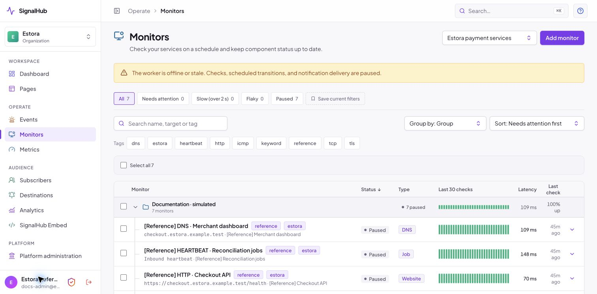
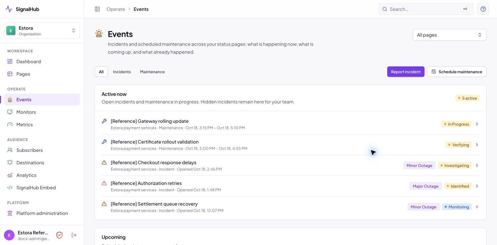
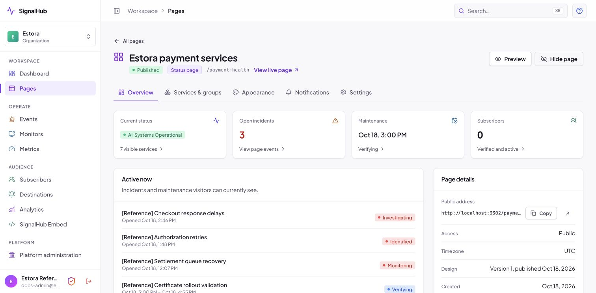
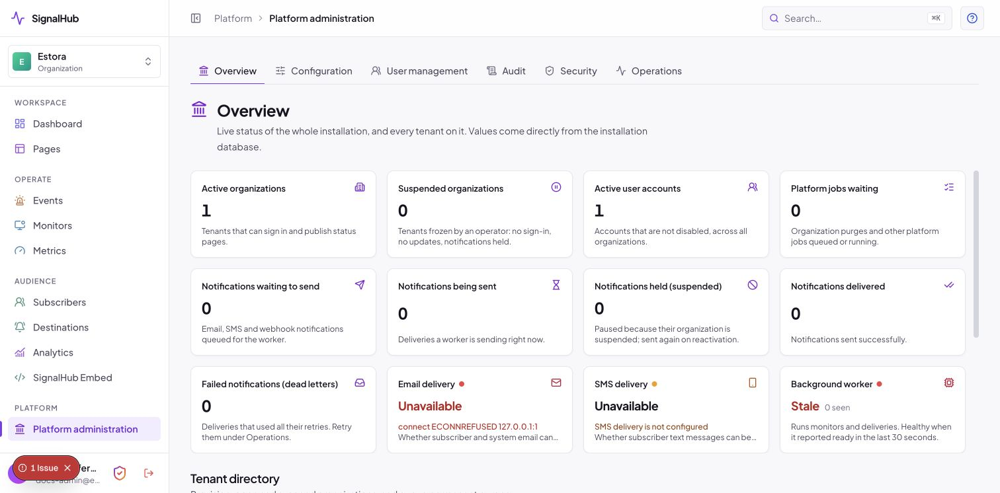
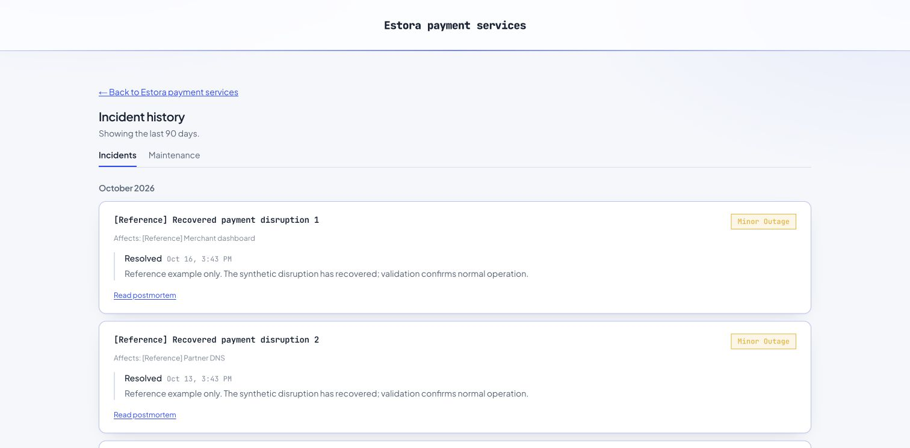
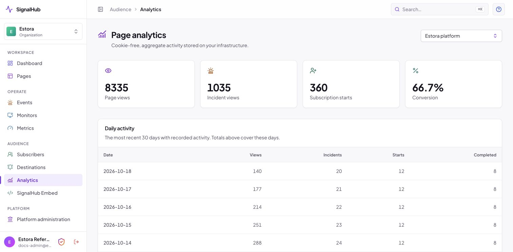
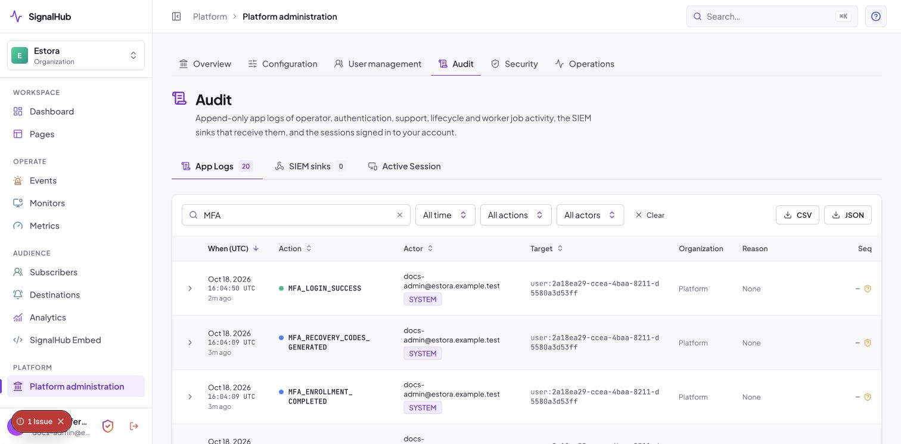
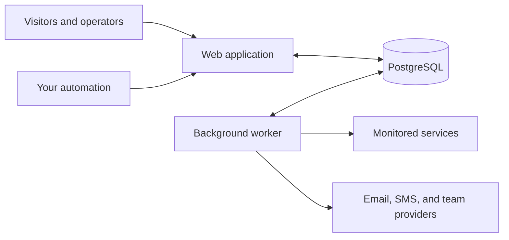

<div align="center">

# SignalHub

**Your services. Your status page. Your infrastructure.**

Open-source status pages, monitoring, and incident communication for teams that want to own the whole workflow.

[Apache-2.0](LICENSE) · [Node.js 22.15.0+](package.json) · [PostgreSQL 14+](docs/deploy/README.md)

[Get started](#quick-start) · [See the product](#from-a-failed-check-to-an-informed-customer) · [Security](#security-and-access) · [Documentation](#documentation) · [Contribute](CONTRIBUTING.md)


*One clear place for customers to check service health.*

</div>

**All images are for reference only.** Every product example uses synthetic Estora reference data. Incidents, uptime, latency, traffic, and subscribers illustrate the application; they are not real service reports or customer endorsements. [Screenshot provenance](docs/reference-data.md).

## Why teams run SignalHub

A status page should connect what your systems detect, what your team knows, and what your customers need to hear. SignalHub brings those pieces into one self-hosted application.

- **Own your operational data.** Pages, incidents, subscribers, uploaded assets, and audit history stay in your PostgreSQL database. You choose the delivery providers and any telemetry export.
- **Connect monitoring to communication.** Checks can update a service, record a metric, open or resolve an incident, and queue notifications through the background worker.
- **Serve different audiences.** Publish public pages, password-protected private pages, audience-specific pages, and hubs that organize several services or products.
- **Give your team controlled access.** Organization roles, page scope, OIDC/SAML sign-in, SCIM provisioning, MFA, revocable sessions, and audit records are included.
- **Run without software seat limits.** Apache-2.0 software has no per-page, per-seat, or per-subscriber license charge. Hosting, storage, and delivery-provider charges still apply.

<a id="-quick-start"></a>

## Quick start

Use Docker Engine 24+ with Compose v2.24+, and PostgreSQL 14+; PostgreSQL 18 is used by the development configuration. The installer can start a bundled database for a trial.

```sh
git clone https://github.com/rameshbgm/signalhub.git
cd signalhub
./install.sh
```

The installer asks for a domain, database choice, and browser or terminal setup. In the browser, open <http://localhost:3301/setup> to connect the database and create your first organization and administrator. SignalHub generates the application keys and persists wizard configuration in its data volume. Back up that volume along with PostgreSQL.

For a local trial with bundled PostgreSQL:

```sh
./install.sh --yes --bundled-db --browser
```

Unlock an unfinished installation with the setup token printed in the server startup logs. Keep that token private and restrict setup access to the intended operator. For production, put TLS in front, set the public URL, configure delivery, and review the [hardening checklist](docs/security.md#production-hardening-checklist).

**Your first session:** create a page, add services, set up monitors, configure a delivery provider and worker, invite your team, then review MFA and runtime settings. The [setup guide](docs/OPEN_SOURCE_SETUP_GUIDE.md) covers each step, upgrades, recovery, and backups.

### Choose your deployment

| Environment | Start here |
|---|---|
| A server or VM | [Installer and Compose guide](docs/OPEN_SOURCE_SETUP_GUIDE.md) |
| Node.js without Docker | [Source installation](docs/deploy/node.md) |
| Kubernetes | [Manifests and deployment guide](docs/deploy/kubernetes.md) |
| Render, Railway, Fly.io, DigitalOcean | [Platform guides](docs/deploy/paas.md) |
| AWS, Google Cloud, Azure | [AWS](docs/deploy/aws.md) · [GCP](docs/deploy/gcp.md) · [Azure](docs/deploy/azure.md) |

<a id="-features"></a>

## From a failed check to an informed customer

### Detect a problem

Monitor HTTP availability, content keywords, TCP ports, DNS records, TLS certificates, ICMP reachability, and heartbeat jobs. Set authentication, intervals, timeouts, thresholds, tags, groups, and recovery behavior. Review recent results alongside latency.



*These reference monitors are paused and use simulated history. Live checks require a running worker.*

### Coordinate the response

Declare an incident, identify affected services, and publish updates as you investigate, identify, monitor, and resolve it. Schedule maintenance separately. Correct incident messages with edit evidence, keep resolved history intact, and hide internal events from the public page when needed.



*One events view brings ongoing incidents and maintenance together.*

### Publish a useful status page

Give each product its own services, groups, uptime view, metrics, incidents, maintenance, and history. Set the layout, style, branding, visitor links, and history window. Preview draft appearance changes before publishing them.



*The page workspace connects customer-facing status with the controls your team uses.*

### Keep people informed

Offer verified email or SMS subscriptions when providers and the worker are ready, plus RSS/Atom feeds. Connect team destinations and signed event webhooks. Add a status badge or incident banner to your own site. Notification controls remain explicit so a reference exercise or backfilled event does not become an accidental announcement.

[Explore notifications and destinations](docs/features.md#notification-destinations-and-providers) · [Read every menu and option](docs/options.md)

### Run several teams from one installation

Organizations separate their pages, people, and operational records. The platform console brings installation health, configuration, identity, queues, and recovery into one place, while organization roles and page scope control everyday access.



*Installation views use a disposable Estora-only database; no other tenant directory is shown.*

<details>
<summary><strong>More product views</strong></summary>

### Public history



### Aggregate analytics



### Audit evidence



[Browse the full screenshot index](docs/screenshots/README.md).

</details>

<a id="-enterprise-grade-security"></a>
<a id="-multi-factor-authentication"></a>

## Security and access

| Area | Included controls |
|---|---|
| Sign-in | Password accounts, authenticator-app MFA, OIDC and SAML 2.0 connections, and SCIM 2.0 provisioning. |
| Team access | Admin, Incident Manager, Responder, and Viewer roles, with optional page restrictions. |
| Account recovery | One-time recovery codes, lost-device requests, administrator review, and audited operator recovery. |
| Sessions | Expiry policy, revocation, trusted-browser controls, and sign out other devices. |
| Secrets | Encrypted stored provider/authenticator material; write-only provider settings; scoped API keys. |
| Audit | Append-only events, hash-chain sealing and verification, CSV/JSON export, and signed SIEM delivery. |
| Deployment | TLS/proxy controls, administration network ranges, rate limits, backups, retention, and key rotation. |

Security depends on how you deploy and operate the installation. Review the [security guide](docs/security.md), [MFA guide](docs/mfa.md), and [enterprise evaluation](docs/enterprise.md). Report vulnerabilities privately through [SECURITY.md](SECURITY.md).

<a id="-architecture"></a>

## Architecture



The web application serves pages, the console, and APIs. The worker runs checks, notifications, exports, audit delivery, maintenance transitions, and retention. PostgreSQL holds shared state, jobs, assets, and exports. The default container runs migrations, web, and worker; they can also run separately.

The application uses Next.js 16, React 19, TypeScript, Tailwind CSS 4, Kysely, and Graphile Worker. Source development requires Node.js 22.15.0+; the container uses Node.js 24. [Deployment architecture and scaling](docs/operations.md).

<a id="-rest-api"></a>

## Automation and API

Create a scoped API key, restrict it to the pages it needs, and set expiry or source-network constraints where appropriate. The OpenAPI document is available from your installation at `/api/openapi`.

```sh
# Read public status.
curl https://status.example.com/api/v1/status/your-page

# Create an incident using a key with incidents.write.
curl -X POST https://status.example.com/api/v1/manage/incidents \
  -H "Authorization: Bearer $SIGNALHUB_API_KEY" \
  -H "Content-Type: application/json" \
  -d '{"pageId":"<page-id>","name":"Elevated API latency","status":"INVESTIGATING","impact":"MINOR","body":"We are investigating delayed requests.","pageWide":true}'
```

Management APIs currently cover service status, incident creation/updates, and metric ingestion. Heartbeat links, inbound service webhooks, banner embeds, and SVG badges support other automation flows. [API and key reference](docs/options.md#installation-and-developer-options).

<a id="-cli"></a>

## Operator CLI

```sh
docker compose exec signalhub node dist-runtime/signalhubctl.mjs doctor
```

| Command | Purpose |
|---|---|
| `setup` | Configure a database and first administrator from the terminal. |
| `preflight`, `doctor`, `migrate --check` | Check configuration, runtime health, and schema state. |
| `backup`, `restore` | Create and restore checksummed PostgreSQL backups. |
| `audit` | Verify the audit chain. |
| `export --org <id>` | Queue an organization export. |
| `settings show`, `export`, `import`, `reset` | Inspect, back up, restore, and recover runtime settings. |
| `rotate-encryption-key` | Re-encrypt saved secrets with the active key. |
| `reset-password --username <id> [--clear-mfa]` | Recover an operator account. |

See [operations](docs/operations.md) before a restore, recovery, or key rotation.

<a id="-documentation"></a>

## Documentation

| Need | Guide |
|---|---|
| Install or upgrade | [Complete setup guide](docs/OPEN_SOURCE_SETUP_GUIDE.md) · [Deployment choices](docs/deploy/README.md) |
| Learn the console | [User manual](https://signalhub.at/docs/user-manual.html) · [Menus and options](docs/options.md) |
| Explore features | [Feature guide](docs/features.md) · [Screenshot index](docs/screenshots/README.md) |
| Configure an installation | [Environment and runtime settings](docs/configuration.md) |
| Secure and operate it | [Security](docs/security.md) · [MFA](docs/mfa.md) · [Operations](docs/operations.md) |
| Evaluate fit | [Enterprise evaluation](docs/enterprise.md) · [Comparison notes](docs/comparison.md) |
| Understand the examples | [Estora reference data](docs/reference-data.md) |
| Develop or contribute | [Contributing](CONTRIBUTING.md) |

The public marketing site, online manual, and interactive demos are maintained in the separate `signalhub.at` project at [signalhub.at](https://signalhub.at/). This application checkout keeps the repository guides and their screenshots. The application runs at <http://localhost:3301/> and links to the online manual. [Project separation](docs/landing-page.md).

## Develop locally

```sh
npm ci
cp .env.example .env
# Configure PostgreSQL and application keys as described in CONTRIBUTING.md.
npm run db:migrate
printf '%s' 'choose-a-long-development-password' | npm run bootstrap -- --password-stdin
npm run dev:all
```

Run `npm run verify` before opening a pull request. Database integration tests need an explicitly configured disposable test database. [Development setup and repository conventions](CONTRIBUTING.md).

## Current scope

The feature and option guides describe shipped behavior. Custom status-page domains, AI assistance, translated content, broader management endpoints, multi-region probes, and passkeys remain roadmap ideas.

## Contributing and license

Bug reports, documentation, tests, and focused improvements are welcome. Read [CONTRIBUTING.md](CONTRIBUTING.md) and use [GitHub issues](https://github.com/rameshbgm/signalhub/issues) for ordinary reports.

SignalHub is licensed under [Apache-2.0](LICENSE). You may use, modify, and run it commercially under that license.

## Acknowledgments

Thank you to [Sarvesh](https://www.linkedin.com/in/sarvesh-chand-ab634336/) and [Rohit](https://www.linkedin.com/in/rohit-pokhriyal/) for their help with SignalHub’s development and contributions to the project.

Thank you to [Miget](https://miget.com/) for sponsoring the infrastructure for our public demo.
