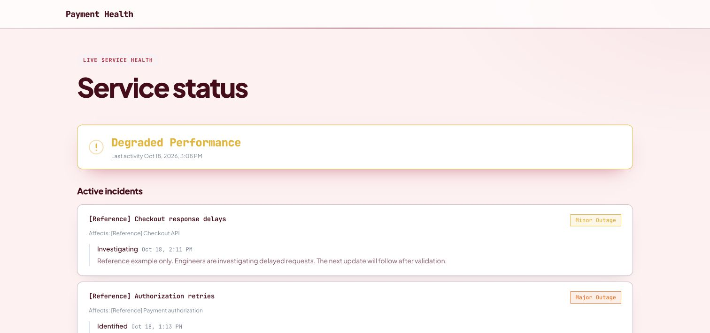

# SignalHub documentation

Everything you need to install, run, secure and extend SignalHub. New here? Start with the [setup guide](OPEN_SOURCE_SETUP_GUIDE.md), then switch on [multi-factor authentication](mfa.md).

**All images are for reference only.** Screens use Estora development data and do not represent real availability. The [online documentation](https://signalhub.at/docs/) is maintained independently in the separate `signalhub.at` website project; see [project separation](landing-page.md).

## Find your guide

| I want to… | Read |
|---|---|
| Look up every menu, field family and supported option | [Menu and option reference](options.md) |
| Understand Estora sample data and reference images | [Reference data](reference-data.md) |
| See every feature with a screenshot and how to use it | [Feature guide](features.md) |
| Install SignalHub on a server in minutes | [Setup and deployment guide](OPEN_SOURCE_SETUP_GUIDE.md) |
| Deploy to Kubernetes, Render, Railway, Fly.io, AWS, Google Cloud or Azure | [Deployment overview](deploy/README.md) |
| Run it with Node.js and no Docker | [Node.js guide](deploy/node.md) |
| Look up an environment variable or a setting | [Configuration reference](configuration.md) |
| Configure service groups, public history, subscriptions, retention, and demo data | [Public pages and data lifecycle](public-pages.md) |
| Protect sign-in with authenticator codes | [Multi-factor authentication](mfa.md) |
| Evaluate SignalHub for an enterprise: responsibilities, controls, evidence, architectures | [Enterprise evaluation](enterprise.md) |
| Understand what is encrypted, audited and hardened, and the threat model | [Security and data protection](security.md) |
| Back up, restore, rotate keys, monitor, scale | [Operations](operations.md) |
| See how SignalHub compares and what it costs | [Comparison](comparison.md) |
| Change the application homepage or deploy the separate marketing website | [Landing pages](landing-page.md) |
| Click through every screen as an end user or admin | [Online user manual](https://signalhub.at/docs/user-manual.html) |
| Contribute code or docs | [CONTRIBUTING.md](../CONTRIBUTING.md) |
| Report a vulnerability | [SECURITY.md](../SECURITY.md) |

## The product in pictures

<table>
<tr>
<td width="50%"></td>
<td width="50%"></td>
</tr>
<tr>
<td align="center">What your customers see</td>
<td align="center">What your team runs</td>
</tr>
<tr>
<td></td>
<td></td>
</tr>
<tr>
<td align="center">Two-step sign-in</td>
<td align="center">Admin-approved recovery</td>
</tr>
</table>

## Screenshot index

| Area | Screenshots in `screenshots/` |
|---|---|
| Public pages | `public-status-page`, `public-status-operational`, `public-incident`, `public-history`, `public-hub` |
| Service groups and history | `public-service-groups`, `public-services-expanded`, `public-maintenance-history`, `admin-service-group-settings`, `admin-page-services`, `platform-retention` |
| Setup and sign-in | `setup-2-database`, `setup-2-database-url`, `login`, `forgot-password` |
| Organization | `admin-dashboard`, `admin-pages`, `admin-page-editor`, `admin-incidents`, `admin-maintenance`, `admin-monitors`, `admin-metrics`, `admin-subscribers`, `admin-destinations`, `admin-embed`, `admin-analytics` |
| Multi-factor | `mfa-enroll`, `mfa-recovery-management`, `mfa-login-code`, `mfa-lost-device`, `mfa-settings-devices`, `mfa-step-up`, `mfa-cancel-request`, `platform-mfa-setting`, `platform-mfa-requests`, `platform-mfa-approve`, `platform-users-mfa`, `platform-user-mfa-dialog`, `platform-audit-mfa` |
| Platform | `platform-overview`, `platform-users-roles`, `platform-api-keys`, `platform-identity-sso`, `platform-sessions`, `platform-audit`, `platform-configuration`, `platform-abuse-protection`, `platform-operations` |
| Feature guide extras | `admin-incident-new`, `admin-maintenance-new`, `admin-monitor-new`, `admin-monitor-edit`, `admin-monitor-auth`, `admin-monitor-thresholds`, `admin-team`, `admin-settings`, `admin-help`, `admin-page-status-pages`, `admin-page-appearance`, `admin-page-notifications`, `admin-page-settings`, `public-subscribe`, `public-hub`, `public-private-gate`, `public-audience-gate` |
| Workspace welcome | `application-workspace` |

Refreshed desktop screenshots preserve the current browser viewport and use Estora reference data; the mobile public view is 390×844. The current screenshot index records the verified reference captures. See the [complete screenshot file index](screenshots/README.md). How to retake them: [CONTRIBUTING.md](../CONTRIBUTING.md#documentation-and-screenshots).
