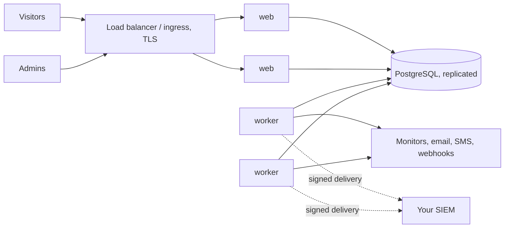

# SignalHub for enterprise evaluation

Everything a security, platform or procurement team usually asks before approving a self-hosted tool: who is responsible for what, which controls exist and where to see them, how to run it reliably, and what evidence you can export. Every statement here describes behavior implemented in this repository and can be checked in the product or the code.

> SignalHub is software you operate. It does **not** claim SOC 2, ISO 27001, GDPR or HIPAA certification, and nothing here is legal advice. The tables below map product capabilities to control themes so your own assessor can reuse them as evidence. Compliance stays your organization's responsibility. See [security.md](security.md).

## Who it is for

Platform, SRE and security teams that need customer-facing status pages, monitoring and incident communication, but cannot send customer lists and incident history to a third party, or must put the tool behind their own identity provider, network and logging.

## Shared responsibility

| Area | SignalHub provides | You provide |
|---|---|---|
| **Infrastructure** | Container images, Kubernetes manifests, Compose files, a setup wizard, health endpoints | Hosts or cluster, networking, TLS termination, capacity |
| **Database** | Numbered migrations with checksums, advisory-locked upgrades, backup and restore commands with checksums | PostgreSQL 14+ operations: availability, replication, TLS, encryption at rest, backups on a schedule, restore drills |
| **Secrets** | Generated session and encryption keys, versioned keyrings, rotation commands, secrets never shown again after saving | A secret manager, backups of `ENCRYPTION_KEY(S)` kept separately from the database, rotation procedure |
| **Identity** | Local accounts with Argon2id, authenticator-app MFA, OIDC, SAML 2.0, SCIM 2.0, RBAC, sessions you can revoke | Your IdP policy, joiner-mover-leaver process, who is an administrator, at least two administrators |
| **Network** | SSRF guards, tunable rate limits, security headers, optional admin-network restriction | Firewalls, reverse proxy, WAF if required, outbound egress policy for the worker |
| **Logging** | A tamper-evident audit log, CSV and JSON export, signed SIEM delivery, structured logs, Prometheus metrics, OpenTelemetry traces | A SIEM, alert rules, retention beyond the default, reviewing the logs |
| **Software supply chain** | Local verification commands, lockfile-pinned dependencies, source Dockerfile, and checksummed migrations | CI gates, image publishing and signing, SBOM and provenance generation, pinning by digest, patching cadence |
| **Data protection** | Consent flows, one-click unsubscribe, retention, export, purge, no telemetry | Lawful basis, records of processing, subject requests, choice of region and providers |

## Controls and where to see them

| Control theme | What SignalHub does | See it in the product | Evidence you can export |
|---|---|---|---|
| **Logical access** | Four roles over ten capabilities, optional per-page scope, separate and IP-restrictable platform administration, last-admin protection | User management; Configuration → Runtime | User list, audit log |
| **Strong authentication** | Authenticator-app MFA for every sign-in when enabled, two devices, single-use recovery codes, replay protection, lockout, no session before the code | Security; Configuration → Runtime → Sign-in policy | `MFA_*` audit events, MFA status per user |
| **Account recovery** | Admin-approved removal, owner notified with a cancel link, no self-approval, cooldown, audited break-glass | Security → MFA requests | `MFA_REQUEST_*`, `MFA_ADMIN_RESET`, `MFA_BREAK_GLASS` events |
| **Federation and provisioning** | OIDC, SAML 2.0 and SCIM 2.0 with group-to-role mapping and deprovisioning | Security → Identity | Connection list, audit entries |
| **Session management** | Idle and absolute timeouts, revocable sessions, sign out other devices, sessions end when MFA is switched on | Audit → Active session | Session list |
| **Account lifecycle** | Expiring single-use invitations, disable and delete with MFA cleanup, SCIM deprovisioning | User management | `GLOBAL_USER_*` audit events |
| **Cryptography** | AES-256-GCM for stored credentials, TOTP secrets and subscriber contacts; Argon2id passwords; hashed tokens and recovery codes; rotatable keyrings | Operations guide: rotating keys | `signalhubctl rotate-encryption-key` output |
| **Audit logging** | SHA-256 hash chain, sealed in batches, CLI verification, CSV and JSON export, signed delivery to your SIEM, 7-year default retention | Audit | `signalhubctl audit`, exports, SIEM copies |
| **Monitoring** | Health and readiness endpoints, Prometheus metrics, worker heartbeats, dead-letter visibility | Operations | `/api/health/ready`, metrics scrape |
| **Network protection** | Connect-time SSRF guards, database-backed rate limits you can tune, CSP and other headers, optional admin network allow-list | Deployment → Abuse protection | `settings show` and `settings export` |
| **Availability** | Stateless web and worker replicas, lease-based idempotent sweeps, readiness and liveness probes, optional readiness gate on a fresh worker heartbeat | Operations | Deployment manifests |
| **Backup and recovery** | `signalhubctl backup` and `restore` with SHA-256 manifests, a documented restore drill | Operations guide | Backup manifests, drill record |
| **Change and release integrity** | `npm run verify` runs lint, typecheck, tests, and the build; applied migrations are checksummed and refuse to run if edited. Automated CI and image publishing must be configured by the operator | Contributor and deployment guides | Verification output, migration checksums, and evidence from your release process |
| **Privacy and retention** | Double opt-in, unsubscribe, per-organization retention, export and purge, cookie-free analytics, no telemetry | Configuration → Organization | Export files, retention settings |

<table>
<tr>
<td width="50%"></td>
<td width="50%"></td>
</tr>
<tr>
<td align="center">Sealed, exportable audit trail</td>
<td align="center">Session visibility and revocation</td>
</tr>
<tr>
<td></td>
<td></td>
</tr>
<tr>
<td align="center">Four-eyes account recovery</td>
<td align="center">Federation with your identity provider</td>
</tr>
</table>

## Reference architectures

**Single host.** One container (web, worker, migrations) and one PostgreSQL database behind a reverse proxy that terminates TLS. Good for dozens of pages and a few hundred monitors. See the [setup guide](OPEN_SOURCE_SETUP_GUIDE.md).

**Highly available.** Run several web replicas and at least two workers against one managed, replicated PostgreSQL. Sweeps are lease-based and idempotent, so extra workers are safe, and with `REQUIRE_WORKER=true` web readiness depends on a recent worker heartbeat, so a load balancer only routes to replicas that can do their work. The Kubernetes base in `deploy/kubernetes/base` ships two web replicas, a worker deployment, probes, an ingress and a network policy; add worker replicas for more monitors.

**Network posture.** Put Platform administration behind your office or VPN range (`PLATFORM_ADMIN_ALLOWED_CIDRS` or Configuration → Runtime). Keep the database network internal, restrict worker egress to what your monitors and providers need, and leave private-target monitoring off unless you need it.

## Evidence pack

What you can hand an assessor, produced from the installation itself:

| Evidence | How |
|---|---|
| Hardening status | Configuration → Runtime → Security checklist (screenshot) and `signalhubctl preflight` |
| Effective configuration | `signalhubctl settings show` (every value with its source) and `settings export` (a restorable file of runtime settings, which hold no credentials) |
| Audit trail and integrity | Audit → export CSV or JSON, and `signalhubctl audit` (non-zero exit on a break) |
| Access review | User management (roles, page scope, MFA status), Active session, `GLOBAL_USER_*` and `MFA_*` events |
| MFA enforcement | Deployment → Sign-in policy, MFA status column, `MFA_LOGIN_*` events |
| Release integrity | Verification output and pinned image digest; signatures, SBOM, and provenance from your own release process if configured |
| Backup and restore | `signalhubctl backup` manifest and a restore drill record |

## Due-diligence answers

| Question | Answer |
|---|---|
| Where is our data stored? | Only in the PostgreSQL database and storage you provide, including uploaded images and exports. |
| Does the software send telemetry or call home? | No. The only outbound traffic is what you configure: monitors, your email and SMS providers, webhooks and destinations, SSO providers and an optional OTLP endpoint. |
| Which sub-processors are involved? | None are built in. Email, SMS and chat providers are the ones you choose and configure. |
| How are secrets protected? | Encrypted with AES-256-GCM using a versioned keyring, shown once, and rotatable without downtime. Tokens, API keys, OTPs and recovery codes are stored hashed. |
| Is multi-factor authentication supported? | Yes: authenticator-app codes for every sign-in, enforced by one installation-wide switch, with recovery codes, lockout and replay protection. SSO users follow your identity provider's MFA. [MFA guide](mfa.md) |
| Can administrators be restricted by network? | Yes, Platform administration can be limited to given CIDR ranges. |
| How is the audit log protected? | Entries are SHA-256 chained and sealed; `signalhubctl audit` verifies the chain and pruning preserves continuity. |
| Can we stream logs to our SIEM? | Yes, signed HTTPS delivery with retries and a dead-letter view. |
| How do we deprovision a leaver? | Disable the account (devices and pending MFA requests are removed and sessions revoked) or deprovision through SCIM. |
| How are vulnerabilities reported? | Privately, as described in [SECURITY.md](../SECURITY.md). We acknowledge within 5 business days; the latest release and the previous minor are supported. |
| Is there a penetration test or certification? | Not claimed. Plan your own assessment; the controls above are what you can show it. |
| What is the uptime commitment? | None from the software: you operate it. The architecture above is how to reach your own target. |
| Can we run it air-gapped? | Yes, for the app itself. Monitors, email, SMS, webhooks and SSO need the network paths you allow. |

## Next steps

1. Read [security.md](security.md) for the threat model and [mfa.md](mfa.md) for the sign-in design.
2. Follow the [setup guide](OPEN_SOURCE_SETUP_GUIDE.md), then [Turn on MFA](OPEN_SOURCE_SETUP_GUIDE.md#turn-on-mfa).
3. Run the [production hardening checklist](security.md#production-hardening-checklist) and keep the evidence above.
