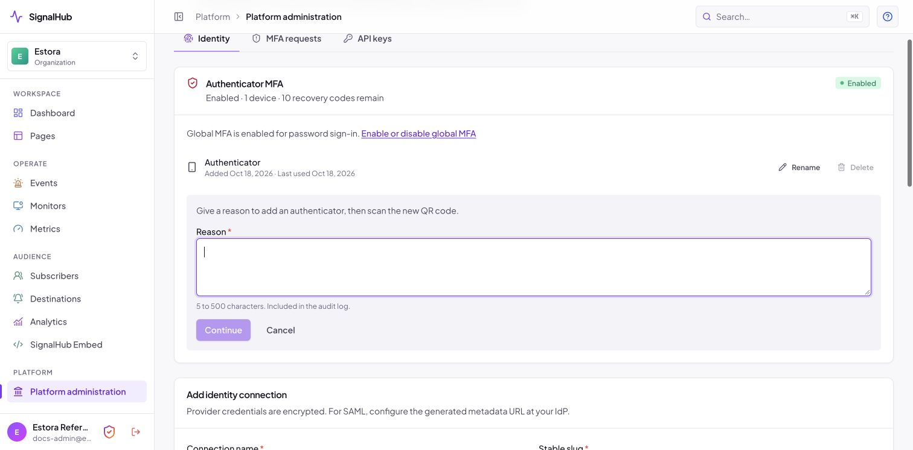
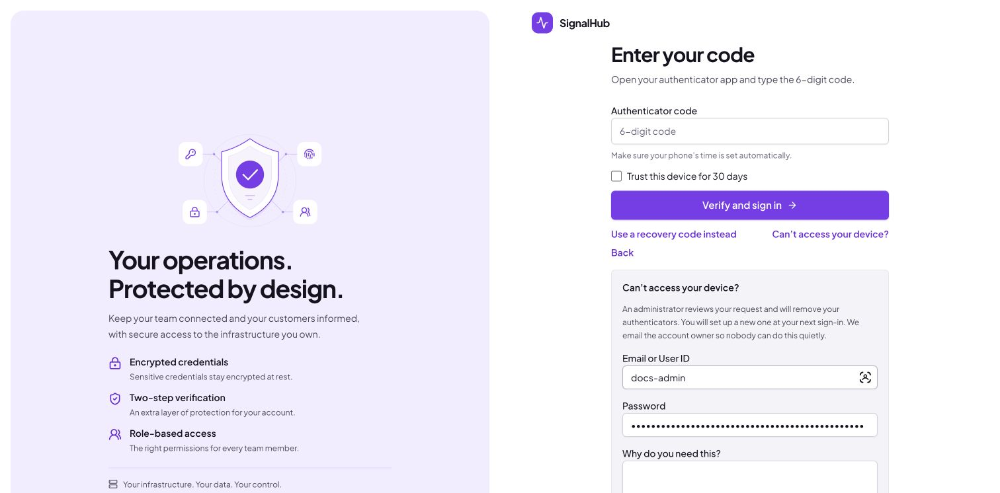
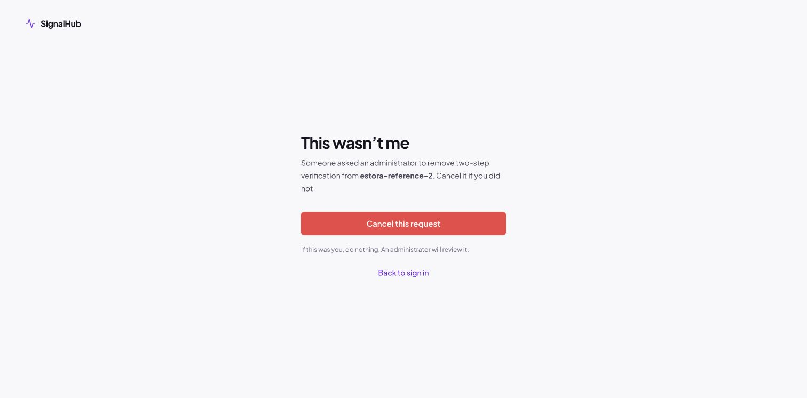
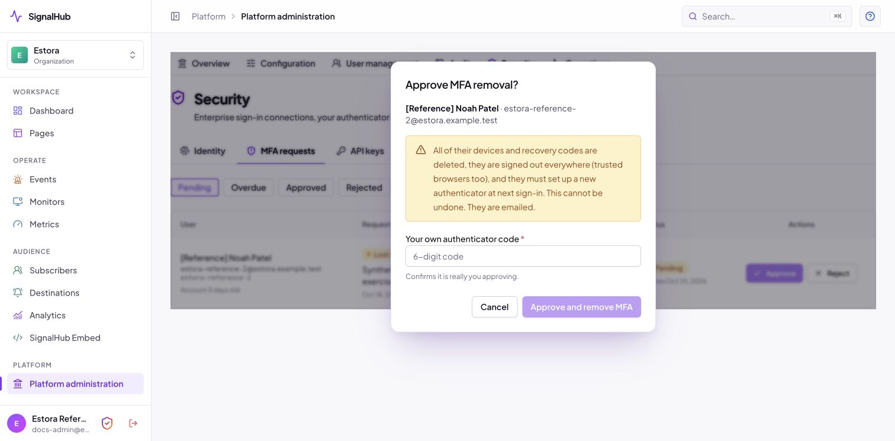
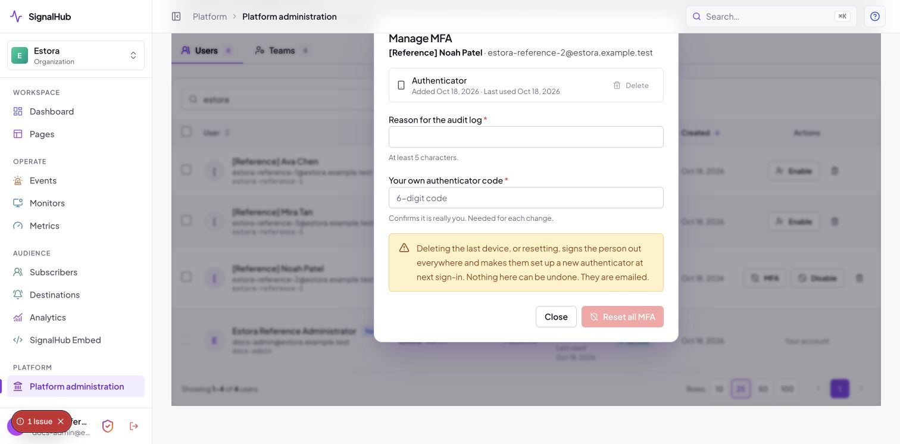

# Multi-factor authentication (MFA)

SignalHub protects sign-in with a six-digit code from an **authenticator app** (Google Authenticator, Microsoft Authenticator, Authy, 1Password and similar). There are no push notifications and no SMS codes, so nothing can be intercepted or approved by accident: the person types a code that only their phone can produce.

This guide covers the whole life cycle for people and for administrators: turning it on, enrolling, signing in, managing devices, recovery codes, lost devices, admin tools and the audit trail. Everything described here is implemented and tested; screenshots were taken from a running instance.

- [At a glance](#at-a-glance)
- [Turn it on](#turn-it-on-administrators)
- [Enroll your first device](#enroll-your-first-device)
- [Signing in](#signing-in)
- [Manage your devices](#manage-your-devices)
- [Recovery codes](#recovery-codes)
- [Lost your device?](#lost-your-device)
- [For administrators](#for-administrators)
- [Security design](#security-design)
- [Emails and audit events](#emails-and-audit-events)
- [Limits, defaults and tunables](#limits-defaults-and-tunables)
- [Operator recovery](#operator-recovery)
- [FAQ](#faq)

## At a glance

| | |
|---|---|
| **Factor** | Authenticator app, time-based six-digit code (TOTP, RFC 6238: SHA-1, 30 s step, one step of clock drift) |
| **Devices** | At most **2** per person and never fewer than **1** once enrolled, enforced under a database row lock so double clicks, two tabs and simultaneous requests cannot break it |
| **Backup** | 10 single-use **recovery codes**, stored as keyed hashes. Copy, **download** or **email to yourself** when they are generated |
| **Convenience** | Optional **"Trust this device for 30 days"**; trusted browsers are signed out automatically whenever a device is added or removed |
| **Brute force** | Five wrong codes lock MFA attempts for 15 minutes (with the minutes left shown), plus per-address and per-account rate limits |
| **Replay** | A code works **once**, even inside its 30-second window |
| **Sign-in** | Two steps. Between the password and the code **no session exists at all**, so nothing is reachable |
| **Lost device** | Self-service request, approved by **another administrator** with their own fresh code, fully automatic and audited |
| **Switch** | One global setting, **off by default** |
| **Public status pages** | Never affected. Visitors and subscribers never see MFA |

## Turn it on (administrators)

MFA is a single installation-wide switch: **Platform administration > Configuration > Runtime > Global MFA > Require authenticator codes**.


| State | What happens |
|---|---|
| **Off** (default) | Nobody is asked for a code, **even people who already enrolled**. Their devices and recovery codes are kept for when you turn it back on. The settings card shows "turned off by your administrator". |
| **On** | Everyone must have a device. People without one are taken through enrollment right after their password. Turning it on **signs out every other session** (sessions opened without a code must not outlive the switch). |

The change is confirm-or-revert like other lock-out-capable settings: press **Keep** within two minutes or the previous value returns. Before enabling:

1. Make sure at least **two administrators** exist so one can approve the other's lost-device request ([why](#lost-your-device)).
2. Configure **email** in Platform administration so people receive security notices and can use "Email to me" for recovery codes (MFA works without email, you just lose those mails).
3. Set the public address (`NEXT_PUBLIC_APP_URL`), because the "this wasn't me" link in request emails is built from it, never from the request's Host header.

> Single sign-on (OIDC, SAML) is governed by your identity provider, including its own MFA through the ACR/AMR checks on the connection. The local code is not asked on top of a successful SSO sign-in.

## Enroll your first device

When the switch is on and you have no device, signing in with your password leads straight here. You cannot reach anything else until it is done.


1. Open an authenticator app and scan the **QR code**. If you cannot scan, choose "enter a setup key" and type the key shown (it can be copied).
2. Type the **six-digit code** the app shows and press **Confirm**.
3. Until that succeeds **MFA is not active**: the setup can be abandoned or restarted, and an unfinished setup expires after **10 minutes** and never counts as a device.
4. Save your [recovery codes](#recovery-codes), tick **"I've saved these"** and continue. You are signed in.

Each setup produces a **brand-new secret and QR code**. A QR code is never reused on a second phone, and the same authenticator can never be registered twice.

The screen reminds you: *make sure your phone's time is set automatically.* Wrong or "expired" codes are almost always a phone clock that drifted.

## Signing in

<table>
<tr>
<td width="50%"></td>
<td width="50%"></td>
</tr>
<tr>
<td align="center"><sub>Step 1: User ID and password</sub></td>
<td align="center"><sub>Step 2: the code from your app</sub></td>
</tr>
</table>

- **Step 1** checks the password. If a code is needed, SignalHub issues a short-lived, single-purpose challenge (a hashed token in an `HttpOnly` cookie, valid 5 minutes) and **creates no session**.
- **Step 2** asks for the code. You can tick **"Trust this device for 30 days"** to skip the code in that browser.
- **"Use a recovery code instead"** switches the field to a recovery code.
- **"Can't access your device?"** opens [the lost-device options](#lost-your-device).
- Friendly errors tell you what happened: *wrong or expired code*, *already used*, or *too many attempts, try again in N minutes*.

## Manage your devices

Open **Security** (the shield in the sidebar footer; administrators find it under Platform administration > Security).


- Each device has a **name you can edit**, an **added on** date and a **last used** date.
- **Add device** is hidden once you have two. Administrators first give an audit reason; other users first confirm with a code from an existing device (valid for 5 minutes). Everyone then scans the new QR code and confirms a code from the new device.
- **Delete** works only when you have two, after an administrator gives an audit reason or another user confirms with a fresh code. The remaining device stays active. With one device the button is disabled with the note *"You need at least one device. To remove all MFA, request removal."*
- Adding or deleting a device **signs out every trusted browser**.



For their own Security settings, signed-in administrators give a reason (5 to 500 characters) instead of an existing-device code when adding or deleting a device, regenerating recovery codes, or requesting removal. The backend checks the role and includes the reason and administrator identity in the audit log. Emailing recovery codes carries the same reason. Other users still need a fresh code for sensitive changes. A new authenticator must always be confirmed with its own code. The card also links to the visible Global MFA switch in Runtime Settings, which uses the existing audited save and confirm-or-revert workflow.

## Recovery codes

Recovery codes are your **backup if you lose your phone** or cannot use the app. Each works once. You receive ten when you enroll.


The reference image shows the regeneration confirmation. Actual recovery codes are intentionally omitted from public documentation.

- They are shown **once** and never again. SignalHub stores only keyed hashes.
- Three buttons: **Copy**, **Download** (a `.txt` file made in your browser) and **Email to me**. Email is sent only to your own address, through the SMTP your administrator configured, at most three times while the codes are on screen, and is recorded in the audit log. Delete the email after you have stored them safely.
- You must tick **"I've saved these"** before you can continue.
- **Use one:** on the sign-in code screen choose *Use a recovery code instead*, type a code, sign in. That code is now used up.
- Using one **emails you** and warns you to regenerate when fewer than **3** remain.
- **Regenerate** from the Security card (administrators give an audit reason; other users need a fresh code). The old codes stop working immediately.

## Lost your device?

On the code screen choose **Can't access your device?** You have two options:



1. **Use a recovery code** (fastest, if you saved them).
2. **I lost my device**: enter your email or User ID, your password and a reason. An administrator reviews the request.

The reply is **always the same generic message**, whether or not the account exists or the password was right, and the form is rate limited, so it cannot be used to find out who has an account. A request is filed only for a correct password.

When it is filed:

- The **account owner is emailed** with a **"This wasn't me, cancel this request"** link, so nobody can quietly reset someone else's MFA. Opening the link changes nothing (mail scanners open links); cancelling needs a button press.
- Every other administrator is emailed.
- There is **one pending request per person**. They can see its status and cancel it from the Security card.
- It expires after **7 days**. After a rejection there is a **24-hour cooldown** before the person can file again.



If your device works again while a request is pending, just sign in normally and cancel the request.

While signed in, **request removal** on the Security card does the same thing. Administrators give a reason without entering a code; other users give a reason and a fresh code. Review and approval rules remain the same.

## For administrators

### Review requests

**Platform administration > Security > MFA requests** (requires the `mfa.manage` capability, which every Admin has).


Filter by **Pending, Overdue, Approved, Rejected, Cancelled, Expired** or All. Each row shows the user, request type (*lost device* or *remove all*), reason, time, **IP address and browser**, **account age** and status. Requests untouched for **3 days** are flagged **Overdue**. Administrators are emailed when a new request arrives.



- **Approve** needs **your own fresh authenticator code**. You cannot approve **your own** request: another administrator must.
- **Reject** needs a **note** (emailed to the user) plus your code.
- **Break-glass**: if you are the **only** administrator, nobody else can approve your request. A clearly labelled break-glass action then appears. It needs your password and the typed words `BREAK GLASS`, is recorded as `MFA_BREAK_GLASS`, and emails the account owner. It is unavailable whenever another administrator exists.

### What approval does

Approval is **one all-or-nothing database transaction**:

1. Deletes **all** of the person's devices and recovery codes.
2. Signs them out **everywhere**, trusted browsers included.
3. Marks them **"must re-enroll MFA at next login"**.
4. Writes the audit record, then emails them *approved, set up MFA at next login*.

At their next sign-in they enter the password and go **straight into enrollment**, with no access to anything until it is done. There is no undo, and the old devices stay deleted.

Races are safe: approving twice, or approving a cancelled or expired request, changes nothing and shows a clear message. If the owner cancels from the email at the same moment an administrator approves, **exactly one wins** (a single conditional update decides) and the other sees a clear message.

### Users and direct reset

**Platform administration > User management** shows each person's **MFA status** (devices, last used, locked out, must re-enroll).


The **MFA** button opens a dialog to **delete a single device** or **reset all MFA**, each with a reason for the audit log and your own fresh code. Deleting the last device forces re-enrollment. **Unlock** clears a lockout. You cannot reset your own MFA (use a request, so a second person is involved).



Disabling or deleting an account removes its devices and cancels its pending requests.

## Security design

| Concern | How it is handled |
|---|---|
| **Secrets at rest** | TOTP secrets are encrypted with AES-256-GCM using the versioned `ENCRYPTION_KEYS` keyring (rotatable). A keyed HMAC of each secret enforces "never registered twice" without storing it in the clear. |
| **Recovery codes** | 48 bits of randomness each, stored only as keyed HMAC-SHA-256 hashes, consumed atomically (a code can only win once, even in a race). Codes carried over from older versions keep working. |
| **Replay** | The last accepted time step is stored **per device** and advanced with a conditional update; the same code is refused a second time inside its window. |
| **No half-signed-in state** | The password alone creates a hashed, single-purpose, expiring challenge, never a session. Enrollment during sign-in is gated on a **confirmed device**: the password alone can never finish a login. |
| **Race safety** | Every add, confirm and delete locks the user row first, then counts devices. The 2-device cap and 1-device minimum hold under concurrent requests (covered by tests that fire them at the same time). |
| **Brute force** | 5 wrong codes lock MFA for 15 minutes (the lock survives restarts and is shown to admins), and database-backed rate limits apply per address and per account on sign-in, settings actions, requests and cancel links. |
| **Step-up** | In personal Security settings, administrators give an audited reason; other users need a fresh code (valid 5 minutes). Confirming a new device still requires its code. Administrative approvals and actions on other users still need the administrator's own fresh code. |
| **Password reset** | Resetting a password **never bypasses or removes MFA**: all sessions end, MFA stays. Only the audited, approved routes above (or the operator CLI) remove it. |
| **Sensitive values** | Setup keys, codes and recovery codes never appear in logs, URLs, error messages, audit metadata or emails. The one deliberate exception is the user-triggered, self-addressed "Email to me" for recovery codes. Audit metadata is passed through a deny-list filter, and the structured logger redacts secret, token, password and recovery keys. |
| **No enumeration** | The lost-device form always answers identically and does its work after the response. |
| **Cancel links** | A single-use, hashed capability token. It can only cancel one pending request. Opening it has no side effect. |
| **Least privilege** | Only administrators with `mfa.manage` can review requests; the screen and every action re-check it on the server. |

Threat notes: SignalHub does not claim phishing-resistant MFA. A user who types a code into a look-alike site can still be phished in real time; WebAuthn/security keys are not implemented today (the device model has room for a future `type`).

## Emails and audit events

Emails are sent through the SMTP provider configured in Platform administration. A mail failure never blocks or undoes a security action.

| Email | To | When |
|---|---|---|
| MFA enabled | the person | first device confirmed |
| Device added / removed | the person | device list changes |
| Recovery code used | the person | sign-in with a recovery code (warns when fewer than 3 remain) |
| Request created | the account owner (with cancel link) and all other administrators | a removal request is filed |
| Request approved / rejected | the person | an administrator decides (rejections include the note) |
| MFA reset by an administrator | the person | direct reset |

Every event is written to the tamper-evident, hash-chained [audit log](security.md#audit-trail) and can be exported or shipped to your SIEM.


| Area | Events |
|---|---|
| Enrollment | `MFA_ENROLLMENT_STARTED`, `MFA_ENROLLMENT_COMPLETED`, `MFA_ENROLLMENT_ABANDONED` |
| Devices | `MFA_DEVICE_ADDED`, `MFA_DEVICE_REMOVED`, `MFA_DEVICE_RENAMED` |
| Sign-in | `MFA_LOGIN_SUCCESS`, `MFA_LOGIN_FAILED`, `MFA_LOCKED`, `MFA_LOCKOUT_CLEARED` |
| Recovery codes | `MFA_RECOVERY_CODES_GENERATED`, `MFA_RECOVERY_CODE_USED`, `MFA_RECOVERY_CODES_EMAILED` |
| Trusted browsers | `MFA_TRUSTED_DEVICE_CREATED`, `MFA_TRUSTED_DEVICES_REVOKED` |
| Requests | `MFA_REQUEST_CREATED`, `MFA_REQUEST_CANCELLED`, `MFA_REQUEST_APPROVED`, `MFA_REQUEST_REJECTED`, `MFA_REQUEST_EXPIRED` |
| Administration | `MFA_ADMIN_RESET`, `MFA_BREAK_GLASS` |

## Limits, defaults and tunables

| Setting | Value | Where to change |
|---|---|---|
| Devices per person | 1 minimum, 2 maximum | fixed |
| Recovery codes | 10 per generation | fixed |
| Setup expiry | 10 minutes | fixed |
| Sign-in challenge | 5 minutes (30 minutes while enrolling) | fixed |
| Fresh-code window | 5 minutes | fixed |
| Trusted device | 30 days | fixed |
| Lockout | 5 wrong codes, 15 minutes | fixed |
| Request expiry / rejection cooldown / overdue flag | 7 days / 24 hours / 3 days | fixed |
| Require authenticator codes | off | Configuration > Runtime > Global MFA |
| `mfa-ip`: code attempts per address | 30 per 15 min | Configuration > Runtime > Abuse protection |
| `mfa-account`: actions per account | 15 per 15 min | Configuration > Runtime > Abuse protection |
| `mfa-request-ip`: removal requests per address | 5 per hour | Configuration > Runtime > Abuse protection |
| `mfa-request-account`: removal requests per account | 3 per hour | Configuration > Runtime > Abuse protection |

## Operator recovery

If **no administrator can sign in** (for example the only administrator lost their phone and no recovery code is left), use the operator command on the server. It needs shell access to the deployment, which is the point:

```bash
docker compose exec signalhub node dist-runtime/signalhubctl.mjs reset-password --username USER_ID --clear-mfa
```

This sets a temporary password that must be changed at sign-in, deletes the person's devices and recovery codes, signs them out everywhere and forces re-enrollment. It is recorded in the audit log as `USER_PASSWORD_RESET_BY_OPERATOR`. To turn MFA off for everyone from the shell (people keep their devices), run `signalhubctl settings reset --key mfaEnabled`; servers pick it up within 30 seconds. If the console itself is unreachable, [`SIGNALHUB_SAFE_MODE`](configuration.md#when-the-admin-console-is-unreachable) ignores saved settings.

## FAQ

**My codes are always rejected.** Turn on automatic date and time on your phone. Codes depend on the clock, and the server accepts only one 30-second step either side.

**Can two people share one authenticator entry?** No. Every device is registered separately with its own QR code and belongs to one person.

**Does MFA protect the public status page?** The public pages are deliberately open. MFA protects the admin console, the platform console and the settings behind them.

**Can I use MFA with an API key?** API keys are separate, scoped, expiring credentials for automation and are not affected by MFA.

**What if I turn the switch off?** Nothing is deleted. People are simply not asked for codes. Turning it back on asks everyone again, and anyone without a device enrolls at their next sign-in.

**Is there an undo for an approved removal?** No. The old devices are deleted. The person enrolls a fresh one.
