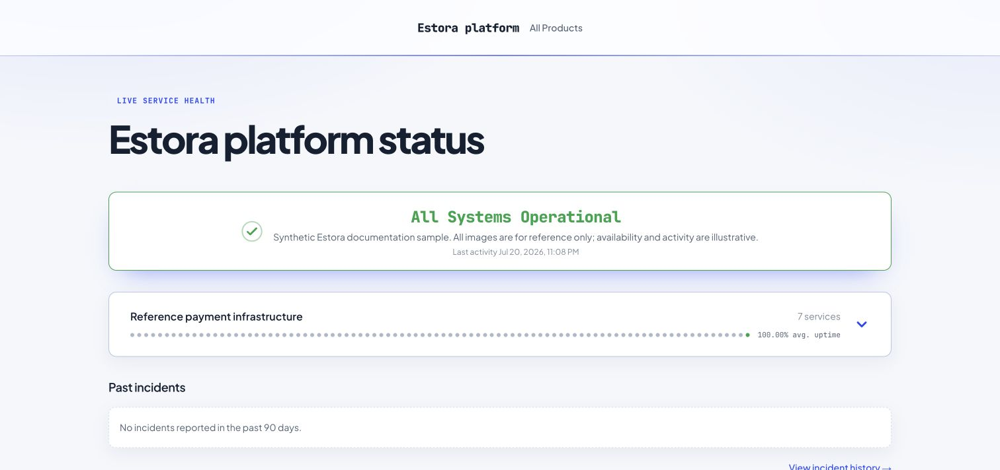
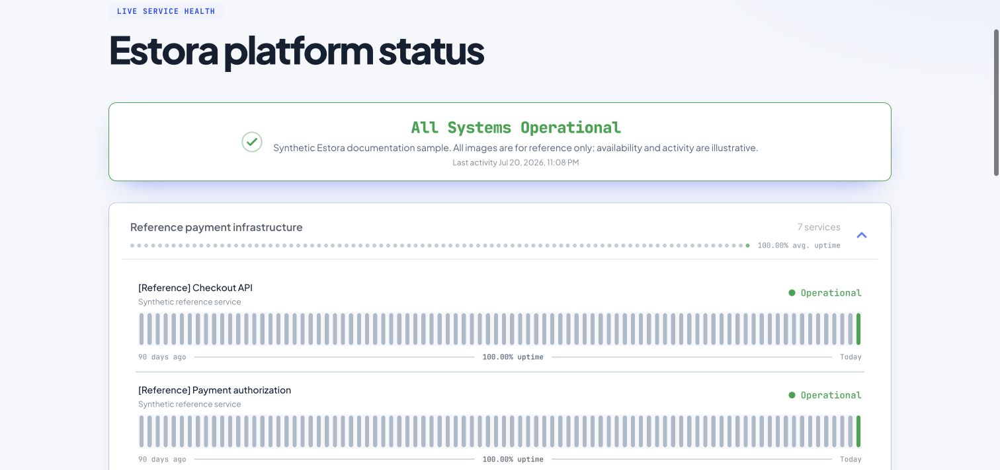
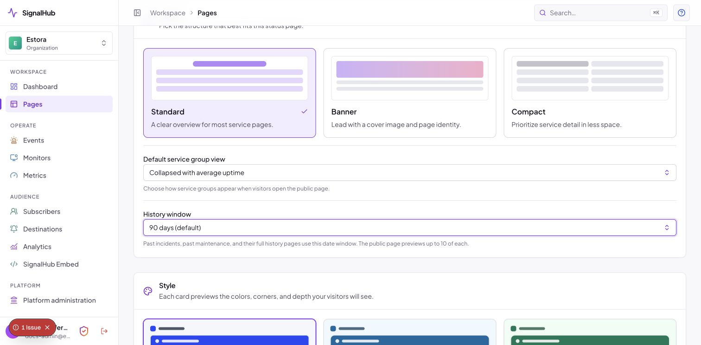
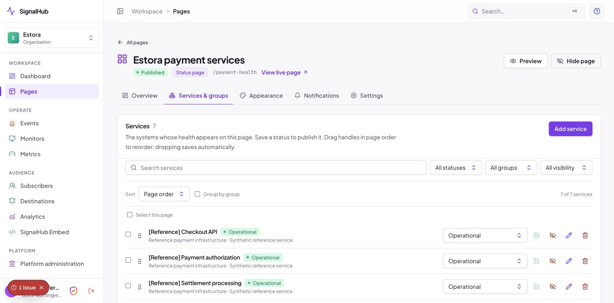
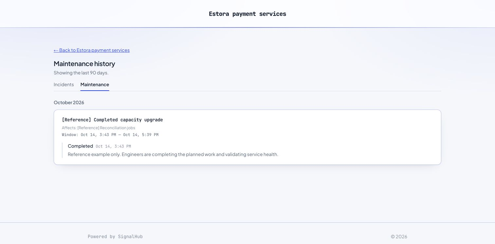
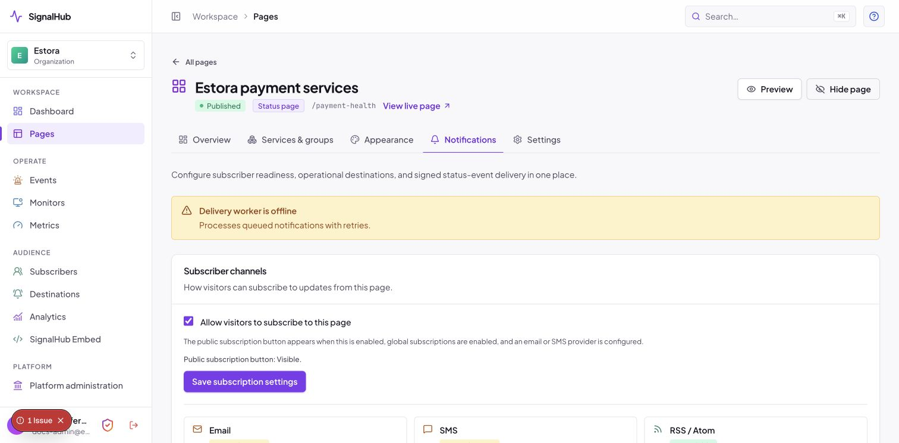
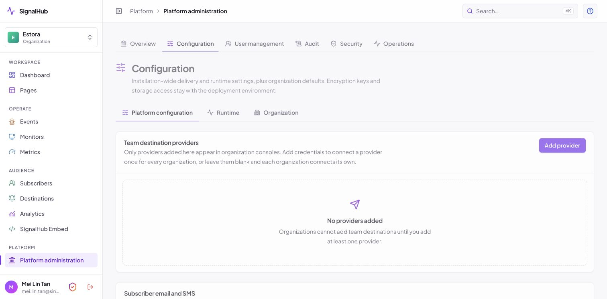
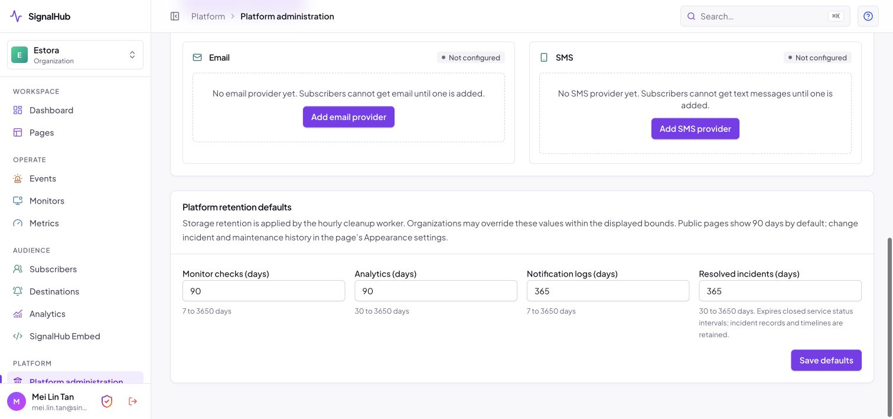
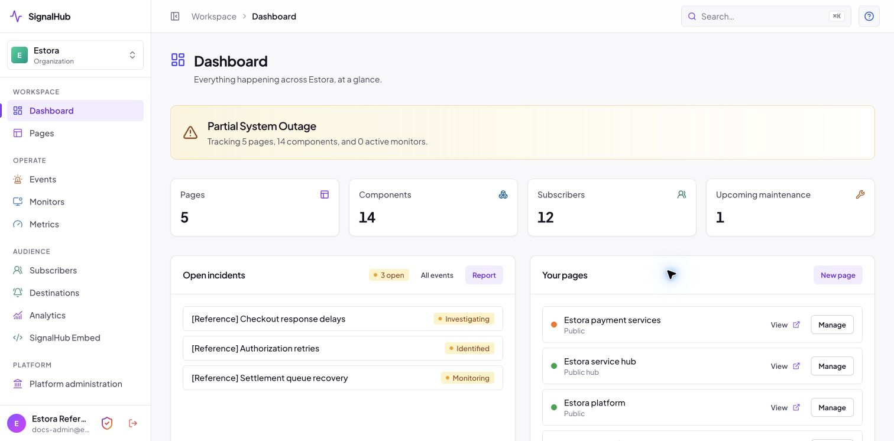

# Public pages, history, retention, and demo data

## Service groups

Choose **Default service group view** when creating a status page:

- **Collapsed with average uptime** is the default. Each closed group shows its service count, a daily history of small solid circles, and average uptime for its services. Color indicates the worst observed service status for that day; the percentage is weighted by observed service time. Unobserved time is excluded rather than counted as uptime.
- **Expanded** opens the service groups so visitors can read individual services and their histories immediately.

Change this later in **Pages → your page → Appearance → Layout**. Appearance changes are saved as a draft; select **Publish changes** to apply them to the public page. The default applies when visitors open the page; they can expand or collapse groups themselves. On narrow screens the group summary shows the most recent 30 circles; the average still covers the configured uptime window. Individual services retain their configured uptime visualization.

## Editing and ordering services

Under **Services & groups**, change a service status and select its green save icon to publish the change. An unchanged value has a disabled save button. Status changes are explicit; changing a dropdown alone does not publish.

Drag a service using its six-dot handle. Dropping saves the order automatically, with a confirmation or an error message. Failed saves restore the previous order. Dragging works with pagination and filters; services outside the displayed set keep their positions. Choose **Page order** and turn off **Group by group** before dragging. Keyboard users can focus the handle, press Space, use arrow keys, then press Space to drop; Escape cancels.

The sidebar footer's **Security** link uses a 24px shield with a gradient outline and red checkmark, and opens your account security settings.

Admin action icons use consistent colors: logout/delete red, help/view blue, external links/edit/history purple, and add/save green. Incident icons reflect severity while resolved incident icons are green; maintenance icons are blue. Existing labels and status badges remain available so color is not the only cue.

## Incident and maintenance history

The public page shows up to **10 past incidents** and **10 past maintenance windows**. A **View incident history →** or **View maintenance history →** link follows the relevant preview. The full history has separate Incidents and Maintenance tabs and includes all eligible records in its date window.

Both previews and full history default to **90 calendar days**, including today. In **Appearance → Layout → History window**, choose 30, 60, 90, 180, or 365 days, then publish. Active incidents and current/upcoming maintenance are separate from this past-history window. Hubs combine history from child pages the visitor can access; access restrictions and public visibility are still enforced.

A published postmortem is linked from its incident card. The incident detail page displays that content directly and does not repeat a link to itself.

## Public subscription controls

The public Subscribe button appears only when:

1. Public subscriptions are enabled globally in **Platform administration → Configuration**.
2. Public subscriptions are enabled for the page under **Notifications**.
3. At least one email or SMS delivery provider is configured and usable.

The dialog offers only available channels. An offline delivery worker is explained in the dialog and prevents OTP submission until delivery is ready. OTP request and verification also enforce the page and platform controls on the server. Disabling public subscriptions prevents new signups; it does not cancel existing subscribers or disable incident delivery to them. RSS/Atom feeds have their own access rules.

## Stored data versus public display

**Platform administration → Configuration → Platform retention defaults** controls storage cleanup. Organization settings can override those values within the allowed bounds.

| Data | Default storage window | Cleanup rule |
|---|---:|---|
| Monitor checks | 90 days | Check timestamp |
| Analytics and metric points | 90 days | Analytics calendar date or metric timestamp |
| Notification logs and finished delivery jobs | 365 days | Log creation or finished-job update timestamp |
| Closed service status intervals | 365 days | Interval end timestamp |

The existing `resolvedIncidentsDays` policy field controls closed service status intervals. **Incident records, completed maintenance records, postmortems, and timeline updates are retained**; the sweep does not permanently delete them. Active status intervals and unfinished notification jobs are also preserved. Audit history keeps its separate 2,555-day policy; expired sessions are removed 30 days after expiry.

The worker applies cleanup hourly. It first removes rows according to each organization's policy and drops whole expired monthly check/metric partitions only when no tenant still needs them. A lease prevents concurrent duplicate sweeps and allows the next hourly run.

Public uptime defaults to 90 days. Incident and maintenance display windows are configured separately in Appearance. Metric charts initially show 90 days, with 24-hour, 7-day, 30-day, and 90-day choices; a visitor's saved chart preference takes precedence on return. Changing storage retention does not create missing history. Selecting a longer public display window only shows data that still exists.

## Development sample data

New installations contain no demo pages, incidents, subscribers, or monitoring history. Setup creates the initial administrator and organization; create pages and services through the console. Sample-data generators are not included.

The documentation screenshots show synthetic development examples captured previously. They are not customer endorsements or reports of real service availability. Create new screenshot examples only in a disposable local installation; see [reference-data guidance](reference-data.md).

## Verification

`tests/integration/retention.test.ts` runs only with an `INTEGRATION_DATABASE_URL` whose database name contains `test`. Use a disposable database: the tests migrate it and run cleanup. They verify default and overridden policies, timestamp boundaries, backfilled analytics cleanup, longer tenant windows, unfinished deliveries, active status intervals, active incidents, and the sweep lease. Public history window boundaries and group summaries also have unit coverage.

Verification for this update: 516 unit tests passed in the isolated commit snapshot (584 passed across the full workspace), the two disposable-database retention integration tests passed, lint and TypeScript checks passed, and Playwright verified automatic ordering across reloads, saved retention settings, collapsed circular summaries, public date windows and preview limits, postmortem links, provider gating, and mobile overflow.

See [Configuration](configuration.md), [Operations](operations.md#retention-and-data-lifecycle), and the [screenshot index](README.md#screenshot-index).
