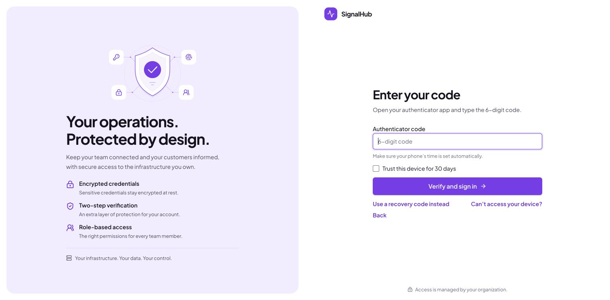

# Security and data protection

What SignalHub does to protect your data, what it leaves to you, and how to report a vulnerability. To report a vulnerability privately, see [`SECURITY.md`](../SECURITY.md).

> This document describes implemented behaviour. It is **not legal advice** and SignalHub does **not claim certification or regulatory compliance** (GDPR, SOC 2, ISO 27001, HIPAA). Self-hosting gives you the controls; compliance is your organization's responsibility.

> Evaluating for your organization? See the [enterprise evaluation guide](enterprise.md): shared responsibility, control-to-evidence map, reference architectures and due-diligence answers.

## Security at a glance

| Layer | Controls |
|---|---|
| **Identity** | Argon2id passwords, authenticator-app MFA with recovery codes and trusted browsers, OIDC, SAML 2.0, SCIM 2.0, idle and absolute session timeouts, revocable sessions |
| **Access** | Four roles over ten capabilities, per-page limits, separate and IP-restrictable platform administration, last-admin protection, scoped API keys with expiry and CIDR allowlists |
| **Data** | Everything in your PostgreSQL, AES-256-GCM for secrets and subscriber contacts with a rotatable keyring, hashed tokens, cookie-free analytics, no telemetry |
| **Detection** | Hash-chained audit log with CLI verification, CSV/JSON export and signed SIEM delivery; every MFA event recorded |
| **Network** | Connect-time SSRF guards, database-backed rate limits, strict security headers, internal database network, non-root containers with all capabilities dropped |
| **Supply chain** | Local verification commands, a source Dockerfile, lockfile-pinned dependencies, and checksummed migrations |

## Where your data lives

Everything is stored in **your PostgreSQL database** (including uploaded images and exports). SignalHub has no built-in phone-home or usage telemetry and no cloud dependency; fonts are self-hosted and the production CSP limits browser scripts, fonts and connections to your own origin. The only outbound server traffic is what you configure: monitor checks, your email/SMS providers, webhooks and destinations, SSO providers and an optional OTLP endpoint.

## Encryption

| What | How |
|---|---|
| Stored credentials: SMTP/SMS passwords, destination configs, webhook and audit-sink secrets, identity connection config, monitor auth secrets, TOTP secrets | AES-256-GCM with a versioned keyring (`ENCRYPTION_KEYS`, active key id) |
| Subscriber contacts (email addresses, phone numbers) | Encrypted at rest, with a separate lookup hash for deduplication |
| API keys, subscription/unsubscribe/feed/heartbeat tokens, OTPs, recovery codes | Stored **hashed**; shown once at creation |
| Passwords | Argon2id (`@node-rs/argon2`), tunable cost, automatic rehash on login, minimum length 14 by default |
| Session cookie `sp_session` | Signed JWT (jose) with a rotating signing keyring |
| In transit | Your reverse proxy terminates TLS; `upgrade-insecure-requests` is set; preflight warns on non-HTTPS URLs |

Rotate keys without downtime: [Operations: rotating keys](operations.md#rotating-keys).

`SESSION_SECRET` signs login sessions; `ENCRYPTION_KEY` encrypts sensitive values saved by the app. They are different keys and must not be reused. Generate each from a cryptographically secure random source, and protect backups of the encryption key separately from database backups.

## Authentication and access control

- **Local accounts** with login throttling per IP and per account (8 attempts / 15 min), forced password change after bootstrap or admin reset, idle and absolute session timeouts, session list and revoke, organization switching.
- **MFA** (full guide: [mfa.md](mfa.md)): authenticator-app codes (TOTP) with up to two devices per person and never fewer than one, keyed-hash single-use recovery codes (copy, download or email to yourself), an optional 30-day trusted browser, lockout for 15 minutes after five wrong codes, and a replay guard so a code works once. **No session exists between the password and the code.** Off by default: turn on **Require authenticator codes** in Platform > Configuration > Runtime > Sign-in policy to require it for everyone (public status pages are never affected, and single sign-on follows the identity provider's own MFA). Lost devices go through an admin-approved request with the owner emailed a cancel link; approval removes every device automatically and forces re-enrollment. The only administrator can use an audited break-glass route, and `signalhubctl reset-password --clear-mfa` remains the operator path. Password resets never bypass or remove MFA.

- **Single sign-on**: OIDC (PKCE-style signed transaction, ACR/AMR checks), SAML 2.0 (one-time, browser-bound transactions and request-ID validation; HTTPS required), per organization or installation-wide.
- **SCIM 2.0** user and group provisioning with hashed bearer tokens and group-to-role mapping. Identities are matched by connection and external subject; global username collisions are rejected, including during rename. SSO login and group synchronization cannot reactivate revoked memberships. Losing all applicable role mappings revokes access and sessions; restoring access requires an explicit administrator or SCIM `active=true` action. Group updates validate all operations before writing and apply them in order; malformed or unsupported updates return 400. Updates allow at most 100 operations and 10,000 members.
- **RBAC**: four organization roles (Admin, Incident Manager, Responder, Viewer) over ten capabilities, optional per-page restrictions, last-admin protection. An Admin in any organization has installation-wide privileges; assign this role only to trusted installation operators. Platform administration can be limited by IP (`PLATFORM_ADMIN_ALLOWED_CIDRS`) and enforces mandatory password-change and MFA completion restrictions at the API/action boundary.
- **Organization suspension**: suspending a workspace blocks its tenant pages, APIs, and organization switching. It does not disable the installation Admin account. A live Admin membership retains platform controls even when every organization is suspended, subject to the existing MFA, password-change, and network checks. Other organization roles cannot use this recovery path.
- **Public API keys** carry explicit scopes (`status.read`, `components.read|write`, `incidents.read|write`, `metrics.read|write`, `analytics.read`), optional page restriction, expiry and CIDR allowlist.
- **Private and audience pages**: a shared password (private) or individual users and groups with per-component visibility (audience). Access sessions are bound to the credential version, so changing a password invalidates them. Protected feeds use scoped tokens; badges avoid caching protected data.

## Audit trail

- **Tamper-evident**: audit entries are chained with SHA-256 (each entry hashes the previous) and sealed in batches. `signalhubctl audit` verifies the chain and exits non-zero on a break; pruning preserves chain continuity. Entries keep the ids of the user and organization they name, so deleting either account never rewrites a sealed entry (migration 025; an installation upgraded from an earlier version may already show a break at an entry whose actor was deleted before the upgrade).
- **Export**: CSV or JSON with a manifest from the platform console.
- **SIEM delivery**: the worker POSTs sealed entries to HTTPS sinks with an HMAC-SHA256 signature, retries and dead-letter visibility. Sinks can be installation-wide or per organization.
- Default retention is 2,555 days (~7 years), configurable.

## Network and application hardening

- **SSRF protection** for monitors, webhooks, destinations and audit sinks: addresses are validated at connect time (defeating DNS rebinding), redirects are never followed, credentials in URLs are rejected, and private, loopback, link-local, CGNAT, multicast and IPv6 ULA ranges are blocked (for webhooks, destinations and audit sinks always; for monitor checks unless you set `MONITOR_ALLOW_PRIVATE_TARGETS=true`).
- **Monitor proxies** (HTTP, HTTPS, SOCKS4, SOCKS5): a proxy would resolve the target name itself and bypass the connect-time check, so the check runs first and the proxy is only handed the already-validated IP address. The proxy server's own address goes through the same check, which means a proxy on a private network (the common case) needs `MONITOR_ALLOW_PRIVATE_TARGETS=true`. Proxy passwords, OAuth2 client secrets and mTLS private keys are encrypted at rest with the same keys as other secrets and are never sent back to the browser.
- **Rate limiting** (database-backed, every limit adjustable at runtime within floors that keep protection on) on login, OTP, page access, SSO start, public status reads, analytics and automation endpoints. Each IP limiter shares one per-address budget across resource names, including unknown pages, so changing a page name cannot allocate a fresh budget. Login and recovery check the IP budget before allocating account counters. Heartbeats have separate IP and monitor budgets (defaults: 1,200 and 120 requests per minute). Client IPs are resolved by an Auto/On/Off proxy-trust setting (Auto trusts `X-Forwarded-For` only from private or loopback connections).
- **Request validation**: JSON and multipart API handlers bound actual streamed bytes before parsing, with a 15-second read deadline. Limits are 64 KiB for normal APIs, 2 MiB for SCIM, 1 MiB for SAML assertions, and 6 MiB for asset multipart requests (individual image restrictions still apply). Invalid JSON returns 400, oversized bodies 413, and timed-out reads 408. Setup unlock has its own smaller limit. Configure matching request and connection limits at the reverse proxy as well.
- **Image uploads** check decoded raster formats and dimensions, normalize images, and validate ICO container directories. Corrupt data and vectors mislabeled as raster images return a validation error instead of reaching storage.
- **Browser API writes** reject foreign origins and cross-site fetch metadata. Native API clients may omit `Origin`; browsers must use the request host or configured application host. The exact SAML assertion callback is exempt because IdPs POST across sites; its signed browser transaction and request binding protect that flow. Next.js also applies its own origin and body checks to Server Actions.
- **Session readiness**: organization switching and protected administration require completed MFA and any forced password change. Switching preserves the authentication method and verification state; MFA management reloads active membership and role from the database instead of trusting a stale cookie role.
- **Outbound payloads**: webhook verification, notification-provider responses, and OIDC discovery/token responses are size bounded. OIDC discovery and token exchange reject redirects; configure canonical IdP endpoints. Audit delivery uses the same connect-time address guard as other webhooks, including for existing sinks, and never follows redirects or connects to private addresses.
- **Headers**: Content-Security-Policy, `frame-ancestors 'self'`, `form-action 'self'`, X-Content-Type-Options, Referrer-Policy, Permissions-Policy, COOP; `X-Powered-By` disabled. Custom page CSS is sanitized (no `@import`, `url()`, `expression()`; 20 KB cap).
- **CSV import/export** neutralizes spreadsheet formula injection.
- **Public messages** from monitors use sanitized failure categories, never raw error text.
- **Containers** run as a non-root user with all capabilities dropped (`cap_drop: ALL`) and `no-new-privileges`; the database network is internal.
- **Supply chain**: `npm run verify` runs lint, typecheck, tests, and the production build. Run `npm audit --audit-level=high` separately to check dependencies. This checkout has no automated CI or image-publishing workflow; configure image signing, SBOM generation, and provenance in your own release process.

Known limits, stated plainly: the production CSP allows inline scripts (a Next.js constraint), IPv6 special-use range blocking is prefix based, and REST management API writes made with API keys are not yet recorded in the tenant audit log.

## Threat model

What SignalHub is built to resist, and where responsibility sits.

| Threat | Mitigation | Yours to do |
|---|---|---|
| Stolen or guessed password | Argon2id, throttling per address and account, MFA, lockout, forced change after reset | Turn MFA on; enforce strong passwords |
| Stolen session cookie | `HttpOnly`, signed with a rotating key, server-side revocation, idle and absolute limits, sessions end when MFA is switched on | Serve over HTTPS; keep timeouts short on shared machines |
| Phone lost or stolen | Recovery codes, admin-approved removal with owner notification, trusted browsers revoked on any device change | Keep recovery codes somewhere safe; have two administrators |
| Social engineering of support | Owner emailed a cancel link, another administrator must approve with a fresh code, self-approval blocked, 24 h cooldown, full audit | Verify the person out of band before approving |
| Account enumeration | Identical responses on sign-in recovery and password reset forms | None |
| Server-side request forgery | Connect-time address validation, no redirects, private ranges blocked | Keep `MONITOR_ALLOW_PRIVATE_TARGETS` off unless needed |
| Insider tampering | Hash-chained audit log, signed SIEM delivery | Ship to a SIEM you control; run `signalhubctl audit` |
| Database or backup theft | Secrets and subscriber contacts encrypted with keys that are not in the database | Store `ENCRYPTION_KEY` separately from backups |
| Real-time phishing of a code | Not preventable with one-time codes | Train users; consider SSO with phishing-resistant MFA at your IdP |

## Privacy and data lifecycle

- **Subscriber consent**: double opt-in via OTP for self-service sign-up; admin-added contacts require an explicit "agreed to receive updates" confirmation; one-click unsubscribe (`List-Unsubscribe`, RFC 2369 and RFC 8058) and a manage-preferences page; hard bounces quarantine the contact.
- **Analytics are cookie-free** and aggregated daily, stored in your database.
- **Retention**: scheduled hourly sweeps delete expired checks, analytics, notification logs, resolved incidents and sessions per policy.
- **Portability**: per-organization data export (gzipped JSON with checksum; secrets and token hashes stripped) from the UI or `signalhubctl export --org <id>`; subscriber CSV export.
- **Erasure**: delete individual subscribers; purge an entire organization through a platform job (cancellable until a worker leases it; a tombstone is retained).

Self-hosting makes it easier to meet data-residency and processor-agreement requirements because you choose the region and the providers, but a data-protection impact assessment, records of processing and request handling procedures remain yours to maintain.

## Production hardening checklist

- [ ] TLS in front, `NEXT_PUBLIC_APP_URL` is `https://`, HSTS at the proxy
- [ ] Proxy trust (Platform administration → Configuration) left on **Auto**, or **On** only when the app is reachable solely via the proxy, with the right number of proxies; check the "What we detected" panel
- [ ] Platform administration networks set to your office/VPN (Configuration → Runtime)
- [ ] Review proxy, HTTPS, and sign-in settings under Configuration → Runtime
- [ ] Rate limits left at their defaults or tighter (Deployment → Abuse protection)
- [ ] Strong, independent `SESSION_SECRET` and `ENCRYPTION_KEY`, stored in a secret manager, backed up separately from the database
- [ ] "Require authenticator codes" turned on; SSO with SCIM where available
- [ ] PostgreSQL with TLS, backups and **tested restores**
- [ ] `METRICS_TOKEN` set and the metrics endpoint not publicly routed
- [ ] SIEM sink configured; periodic `signalhubctl audit`
- [ ] Image pinned by tag/digest and signature verified
- [ ] Key rotation procedure rehearsed

## Reporting a vulnerability

Do not open a public issue for security problems. Follow [`SECURITY.md`](../SECURITY.md) for private reporting. Supported versions are the latest release and the previous minor.

## First-run operator authentication

The setup wizard, database configuration endpoints and configuration backup require the operator token printed by the supervisor at startup. The browser receives an HttpOnly, SameSite=Strict setup cookie (Secure over HTTPS); API automation can supply a bearer token. Setup credentials are accepted only while setup is active. Generated tokens change when the supervisor restarts. Protect server logs, finish setup over TLS or a trusted local connection, and rotate application/database keys if an earlier unfinished installation was publicly exposed.

SSO account links created before the identity ownership fix should be reviewed for unauthorized links. The fix prevents new cross-connection username linking; it cannot determine whether a historical link was legitimate.
